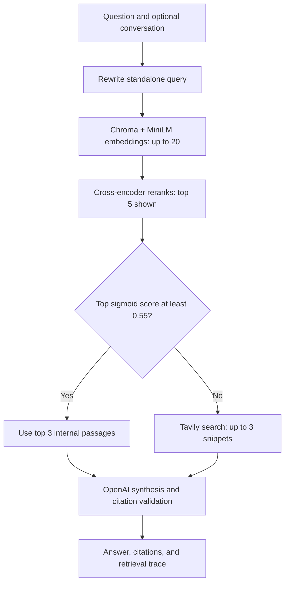

# Harbor Cloud RAG Workbench

AD 331 · John Nelson. Harbor Cloud is a fictional operations platform. This FastAPI
workbench shows query rewriting, dense retrieval, cross-encoder reranking, and
the decision to use internal passages or Tavily web results. Source links reveal
the cited text. Offline preview uses fixed example traces.



## Local setup

Install Python 3.11 and [uv](https://docs.astral.sh/uv/). From the project root in
PowerShell, run:

```powershell
$env:UV_LINK_MODE = "copy"
uv sync --locked
uv run --no-sync python -m pytest -v
uv run --no-sync uvicorn src.app:app --host 127.0.0.1 --port 8003
```

Open [the workbench](http://127.0.0.1:8003). Preview works without credentials.
For live requests, copy `.env.example` to `.env`, replace the placeholders for
`OPENAI_API_KEY` and `TAVILY_API_KEY`, then restart the server. The default
`OPENAI_MODEL` is `gpt-4o-mini`. Keep `.env` out of Git. The first live run
may download both CPU models and populate the local Chroma index.

## Render deployment

Create a Docker Web Service from the repository root. Use `/healthz` for the
health check. Add `OPENAI_API_KEY`, `TAVILY_API_KEY`, and `LIVE_ACCESS_CODE` in
the Render service's environment settings. Choose a random access code, for
example 32 hexadecimal characters. Share it privately with intended reviewers.
The code gates billable requests; preview remains public. The app listens on
Render's `PORT`. The Chroma index and model cache can be rebuilt if the instance
filesystem is replaced. Verify memory use and response times on the actual plan.

## Confidence gate and calibration

The cross-encoder returns raw logits. The application applies sigmoid once and
uses the highest score as a routing signal. The default cutoff of 0.55 is
inclusive for internal retrieval. Scores are rounded in the UI and are not
probabilities that an answer is correct.

Local live checks produced these observed results:

| Question | Expected route | Actual route | Displayed score |
| --- | --- | --- | ---: |
| Staging Kubernetes worker requirements | Internal | INTERNAL_RAG | 1.000 |
| Follow-up about production requirements | Internal | INTERNAL_RAG | 1.000 |
| Standard DNS port | Web | WEB_FALLBACK | 0.000 |

These three smoke checks found no routing errors at the initial cutoff, but
they do not establish an optimal threshold. For calibration, label additional
queries by whether the internal corpus supports an answer. Capture unrounded
top scores. Across candidate thresholds compare **unnecessary web fallbacks**
(answerable internally but sent to the web) with **missed web fallbacks**
(insufficient internal evidence but routed internally). Prefer a cutoff that
reduces missed fallbacks without sending too many supported questions to the
web. Confirm the choice on a separate set.

## AI audit and QA

[The prompt log](ai_prompt_log.md) preserves the original prompt and draft,
followed by findings and source diffs. The audit added corpus fingerprinting,
checks for exact terms lost during rewriting, and validation that cited
excerpts occur in their declared sources. Excerpt validation does not establish
that every claim follows from its source. See [QA notes](QA.md) for what the
automated tests cover and how they differ from live runs.
